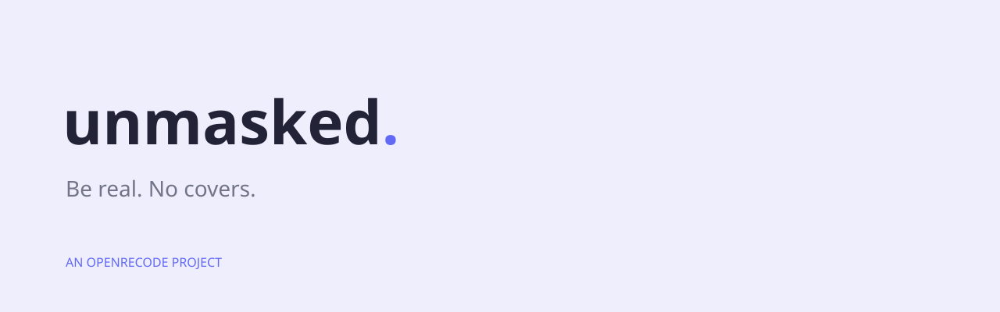
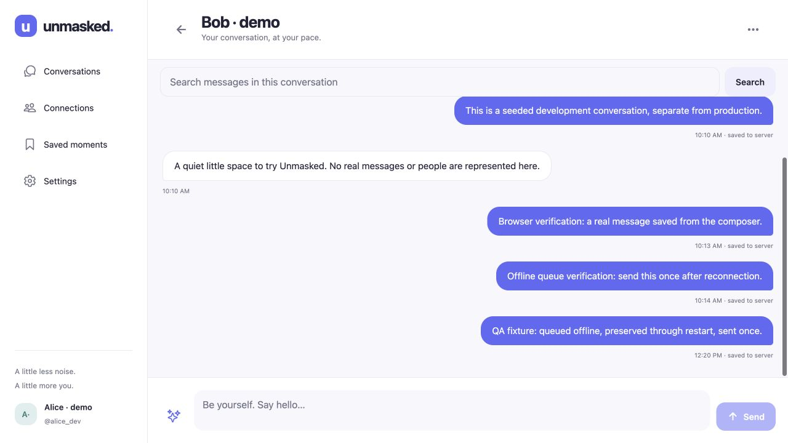

<p align="center"></p>

A quieter space for genuine conversations. **Unmasked** is a self-hostable, privacy-oriented messenger for OpenRecode, built with Expo, Fastify and PostgreSQL. No ads, popularity scores or paid visibility.

**Status:** private, unreleased development implementation. The working account/chat slice is implemented; the full product specification is not finished. **Messages are not end-to-end encrypted.** See [remaining work](docs/ROADMAP.md) and [actual verification results](docs/reports/VERIFICATION.md).

## Get running

Requires Node 24 / npm 11. From this checkout:

```sh
npm ci
cp .env.example .env
npm run db:migrate
# Optional development fixtures; only on an empty local database, before starting the API:
npm run seed
npm run dev
```

Open [the local web application](http://localhost:8081). API: [local health](http://localhost:3001/health). Local development uses persistent embedded PostgreSQL at `.data/unmasked`, without Docker. Verification/reset codes are available through the loopback-only [development mailbox](http://localhost:3001/dev/mailbox) when SMTP is not configured. The optional seed writes random local credentials to `.data/development-accounts.json`; never commit that file or use fixtures in production.

To test with your own accounts: register each account, verify its local mailbox code, create an invitation from Connections, send/accept the request from the other account, then open the conversation. Use separate browser profiles for different users. A request alone does not grant messaging access.

## What works

- Verified accounts, password reset, private profiles and revocable sessions.
- Contact invitations, restricted discovery, blocks, direct chats and small groups.
- Persistent live text messaging, replies/reactions, edits/tombstones, search, cursor history, read privacy, drafts and retry queue.
- Optional prompts and consent-based Unmasked bio/status sharing; private saved moments.
- Profile/theme settings, account/history exports, active-database account deletion and explicit reports.
- Developer Ideas (triple-tap version in Settings), editable SVG branding and an offline public web shell.

## Application preview

Real desktop browser screenshot using explicitly labeled local development fixtures:



## Platforms and commands

Universal source targets iOS, Android and Web. **Web/browser testing does not establish native functionality.** No physical-device or signed release build is claimed.

```sh
npm run mobile       # Expo for native development
npm run web          # Expo Web, port 8081
npm run dev:api      # API only, port 3001
npm run typecheck
npm run lint
npm test
npm run build:web    # production web export plus PWA service worker
npm run preview      # production export on port 8081
npm run branding     # regenerate vector variants and icon exports
```

For self-hosting, configure real PostgreSQL/SMTP and same-site HTTPS origins, then `docker compose build` and `docker compose up -d`. [Deployment instructions](docs/DEPLOYMENT.md) describe secrets, TLS, persistent volumes and rollback. Docker configuration is prepared but not yet executed on this workstation. Native builds require platform toolchains and Android signing credentials; [release instructions](docs/RELEASES.md) distinguish unsigned IPA, simulator app, APK and AAB.

## Architecture and limitations

`apps/mobile` contains one Expo Router client; `apps/api` contains separated auth/identity/messaging/group/product modules; `packages/contracts` shares validation and types; `infra` contains Docker/Nginx; `docs` provides the handoff. Socket events invalidate queries; HTTP authorization and PostgreSQL are authoritative. No private data is sent to an AI provider.

Media/voice, push, passkeys/OAuth, shared bookmarks, audited E2EE, P2P sync, full moderation, native update installers and comprehensive release validation remain outstanding. No public service, store listing or external distribution channel is activated.

[Documentation index](docs/INDEX.md) · [API](docs/API.md) · [privacy](docs/PRIVACY.md) · [security](docs/SECURITY.md) · [contributing](CONTRIBUTING.md) · [changelog](CHANGELOG.md)

Licensed **AGPL-3.0-only**. Copyright © 2026 OpenRecode contributors. See [LICENSE](LICENSE) and [third-party notices](THIRD_PARTY_NOTICES.md). Branding artwork is original; README artwork is not presented as an application screenshot.
